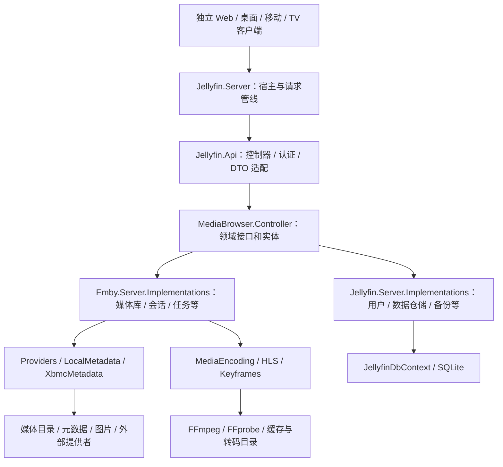
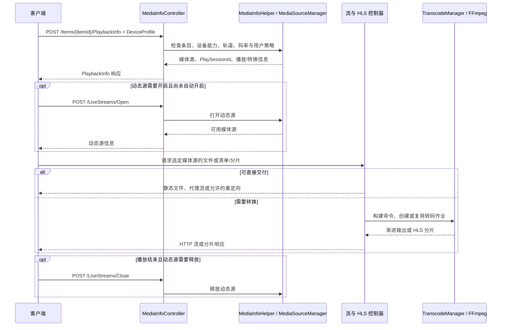

# AniJelly 开发者功能手册

> 整理日期：2026-10-12（Asia/Shanghai）
> 源码基线：`master` / `a45d1415d4`，含弃用 API 与电视直播/DVR 移除后的工作区改动。
> 读者：服务端开发者、客户端接入开发者、插件作者及维护者。

## 1. 范围与阅读方式

当前目录名为 AniJelly，仓库内容仍是 Jellyfin 服务端，主项目目标框架为 `net10.0`，程序集声明版本为 `13.0.0`。这里的版本来自 [SharedVersion.cs](../SharedVersion.cs)，不代表已发布版本。本手册按当前代码说明功能，不依据目录名推断动漫定制能力。

本手册覆盖服务端功能、API 入口、模块分工、数据流、配置及扩展方式。完整入口见 [API 功能入口索引](API功能入口索引.md)：包含 55 个标准控制器和 1 个内置 TMDb 控制器，共 324 条 HTTP 方法与路由声明，兼容别名分别计数。后台任务、WebSocket、启动临时页面等不属于这 324 条声明，在正文补充。

**证据边界：**功能说明以本地源码为依据；本次清理的编译、API 单测和集成验证结果见[手册核验记录](手册核验记录.md)。已验证固定 Web 的设置、登录、空首页和控制台；未验证真实媒体播放、外部服务或硬件转码。Web 客户端来自独立 `jellyfin-web` 项目，服务端负责静态资源托管、API 文档及启动状态页面。当前 [Docker 构建](Docker启动说明.md) 固定获取 Web 源码并依次应用局部兼容、[Cinema 视觉](../docker/Cinema主题说明.md)和电视功能移除三份补丁，统一首次设置、登录、首页和管理配置；具体未适配页面见[兼容说明](../docker/Web兼容说明.md#已知未适配功能)，不能从服务端接口推断所有产品界面均已兼容。

| 阅读目标 | 对应章节 |
| --- | --- |
| 理解模块、启动和数据层 | 第 2–3 章 |
| 查找媒体库、查询、元数据和个人功能 | 第 4–6 章 |
| 理解播放、会话、同步观看及功能移除边界 | 第 7–9 章 |
| 理解认证、管理、插件与后台任务 | 第 10–12 章 |
| 配置、扩展、构建及验证 | 第 13–16 章 |
| 查当前 HTTP 入口 | [API 功能入口索引](API功能入口索引.md) |
| 迁移已删除的旧接口 | [弃用接口迁移说明](弃用接口迁移说明.md) |

## 2. 系统架构与模块职责



此图表示主要调用关系，不是项目引用或依赖注入的完整拓扑。`Emby.*` 与 `MediaBrowser.*` 是沿用的命名，仍属于当前服务端实现，不能视为未使用的兼容目录。

| 模块 | 主要职责与阅读入口 |
| --- | --- |
| [Jellyfin.Server](../Jellyfin.Server) | `Program` 启动、`CoreAppHost` 服务装配、`Startup` HTTP 管线、迁移、健康检查、Web 静态文件与启动状态页 |
| [Jellyfin.Api](../Jellyfin.Api) | REST 控制器、认证与授权处理器、播放辅助类、WebSocket 监听器、请求/响应模型 |
| [MediaBrowser.Controller](../MediaBrowser.Controller) | 领域契约和运行时实体：库、用户、会话、转码、元数据、播放列表、媒体片段等 |
| [MediaBrowser.Model](../MediaBrowser.Model) | API 共享 DTO、配置对象、媒体格式/设备能力模型、任务和通知模型 |
| [MediaBrowser.Common](../MediaBrowser.Common) | 应用路径、网络配置、插件基类和公共基础契约 |
| [Jellyfin.Data](../Jellyfin.Data) | 共享枚举与查询等辅助数据结构；持久化实体主要在 Database 项目 |
| [Emby.Server.Implementations](../Emby.Server.Implementations) | `ApplicationHost`、媒体库扫描和监控、推荐/搜索、合集/播放列表、会话/SyncPlay、转码文件清理任务和插件安装 |
| [Jellyfin.Server.Implementations](../Jellyfin.Server.Implementations) | 用户/设备/认证、显示偏好、活动日志与事件、Trickplay、数据库仓储、完整系统备份 |
| [MediaBrowser.Providers](../MediaBrowser.Providers) | 媒体探测、元数据刷新、内置远程提供者、图片/字幕/歌词/Trickplay 管理 |
| [MediaBrowser.LocalMetadata](../MediaBrowser.LocalMetadata) / [MediaBrowser.XbmcMetadata](../MediaBrowser.XbmcMetadata) | 合集/播放列表 XML、本地图片及 NFO 读写 |
| [Emby.Naming](../Emby.Naming) / [Emby.Photos](../Emby.Photos) | 文件命名识别、季集/多段视频/附加内容解析；照片元数据 |
| [MediaBrowser.MediaEncoding](../MediaBrowser.MediaEncoding) | FFmpeg/FFprobe 探测、转码进程管理、字幕转换与视频附件提取 |
| [Jellyfin.MediaEncoding.Hls](../src/Jellyfin.MediaEncoding.Hls) / [Keyframes](../src/Jellyfin.MediaEncoding.Keyframes) | HLS 播放清单、关键帧缓存和 Matroska/FFprobe 等提取实现 |
| [Jellyfin.Drawing](../src/Jellyfin.Drawing) / [Drawing.Skia](../src/Jellyfin.Drawing.Skia) | 图片处理、拼图、封面叠加信息、启动背景、Skia 编码器 |
| [Jellyfin.Networking](../src/Jellyfin.Networking) | 网络接口与地址判定、绑定与发现、出站 HTTP 连接辅助 |
| [Jellyfin.Database](../src/Jellyfin.Database) | EF Core 上下文、实体、数据库提供者契约、SQLite 与迁移 |
| [Jellyfin.Extensions](../src/Jellyfin.Extensions) / [CodeAnalysis](../src/Jellyfin.CodeAnalysis) | 通用扩展函数；构建时自定义静态分析器 |

服务注册应优先阅读 [CoreAppHost.cs](../Jellyfin.Server/CoreAppHost.cs) 和 [ApplicationHost.cs](../Emby.Server.Implementations/ApplicationHost.cs)。后者的 `RegisterServices` 装配核心管理器，`AddParts` 等初始化逻辑把发现的 resolver、provider、搜索和推荐扩展接到管理器上；不能仅凭一个接口文件判断功能已经启用。

## 3. 启动、请求与持久化

### 3.1 启动生命周期

[Program.cs](../Jellyfin.Server/Program.cs) 的主线为：解析 `StartupOptions` → 建立数据/配置/日志路径 → 初始化日志与配置 → 启动临时 `SetupServer` → 检查资源与存储 → 执行启动前迁移 → 构建 `CoreAppHost` 和 ASP.NET Core Host → 初始化数据库及服务 → 分阶段迁移 → 启动主服务与后台任务。

启动失败或尚未就绪期间，[SetupServer](../Jellyfin.Server/ServerSetupApp/SetupServer.cs) 可以展示启动进度，通常返回 HTTP 503 和 `Retry-After`。它提供启动阶段的 `/health`、`/System/Info/Public` 和仅本地网络可访问的 `/startup/logger`；这组临时处理器不等同于正常运行时的控制器。

[StartupMode](../Jellyfin.Server/Configuration/StartupMode.cs) 还定义 `MigrateSystem` 和 `SeedSystem` 维护模式。后者会强制走种子数据流程，不应作为普通启动选项使用。首次安装的设置 API 位于 `StartupController`，与上面的临时启动状态页是两个机制。

### 3.2 HTTP 与实时通道

[Startup.cs](../Jellyfin.Server/Startup.cs) 配置 `BaseUrl`、转发头、异常处理、压缩、CORS、本地化、静态资源、认证、路由授权、IP 访问校验、WebSocket 和控制器端点。

| 入口 | 提供的能力 | 条件 |
| --- | --- | --- |
| `/web` | 托管独立构建的 Web 客户端文件 | 必须配置非空 Web 资源目录，并启用托管 |
| `/api-docs/openapi.json` | 运行实例的 OpenAPI 定义 | 由 Swagger 中间件生成；隐藏端点不一定出现 |
| `/api-docs/swagger`、`/api-docs/redoc` | 交互式 API 参考 | 定义见 [ApiApplicationBuilderExtensions](../Jellyfin.Server/Extensions/ApiApplicationBuilderExtensions.cs) |
| `/health` | 运行时数据库上下文健康检查 | 正常服务中注册；不是完整播放链路健康证明 |
| `/metrics` | Prometheus 指标 | `ServerConfiguration.EnableMetrics=true`，默认关闭 |
| WebSocket 升级请求 | 会话、播放命令、库变化、用户数据、任务与活动通知 | 经 [WebSocketHandlerMiddleware](../Jellyfin.Api/Middleware/WebSocketHandlerMiddleware.cs) 进入连接管理器，连接仍需认证 |
| UDP 7359 | 局域网服务器自动发现 | [AutoDiscoveryHost](../src/Jellyfin.Networking/AutoDiscoveryHost.cs)，受网络配置控制 |

正常服务下 HTTP 路径均应考虑部署的 `BaseUrl`。WebSocket 由中间件识别升级请求，而不是这份 API 索引中的普通 MVC 动作。

### 3.3 数据层与文件层

持久化核心是 [JellyfinDbContext](../src/Jellyfin.Database/Jellyfin.Database.Implementations/JellyfinDbContext.cs)，当前实体包括用户、权限/偏好、设备、API key、活动日志、媒体条目、媒体流、图片、人物关系、用户观看数据、关键帧、Trickplay 和媒体片段。该文件仍保留一块注释中的替代模型，不属于当前已启用的数据表。

条目查询和写入分别沿 [BaseItemRepository](../Jellyfin.Server.Implementations/Item/BaseItemRepository.cs) 及其 partial 文件、[ItemPersistenceService](../Jellyfin.Server.Implementations/Item/ItemPersistenceService.cs) 等实现；运行时 `BaseItem`、API 的 `BaseItemDto` 和数据库 `BaseItemEntity` 各有用途，改字段时需检查映射、DTO 输出和查询翻译。

[数据库注册](../Jellyfin.Server.Implementations/Extensions/ServiceCollectionExtensions.cs) 当前只内置 `Jellyfin-SQLite`。`PLUGIN_PROVIDER` 可加载实现 `IJellyfinDatabaseProvider` 的程序集，不表示 PostgreSQL 等实现已经包含在仓库中。迁移说明见 [数据库 README](../src/Jellyfin.Database/readme.md)。

数据库之外还有原始媒体、配置、缓存、转码分片、插件及元数据文件。数据库备份不等同于原始媒体备份；修改文件移动、删除或恢复逻辑时要同时检查文件层影响。

## 4. 媒体库、媒体类型与内容发现

### 4.1 媒体库建立与更新

| 功能 | 入口 | 实现与注意事项 |
| --- | --- | --- |
| 虚拟媒体库增删改、一个库挂载多个目录 | `LibraryStructureController`：`/Library/VirtualFolders`、`/Library/VirtualFolders/Paths`、`/Library/VirtualFolders/Paths/Update`、`/Library/VirtualFolders/LibraryOptions` | [LibraryManager](../Emby.Server.Implementations/Library/LibraryManager.cs) 维护库结构与每库配置；移除目录和删除媒体文件是不同操作 |
| 全库扫描与外部变更通知 | `POST /Library/Refresh`、`POST /Library/Media/Updated` | 目录扫描、命名识别、元数据刷新、持久化；兼容电影/剧集变更通知路由见索引 |
| 文件系统实时监控 | 库配置 `EnableRealtimeMonitor` | [LibraryMonitor](../Emby.Server.Implementations/IO/LibraryMonitor.cs) 使用文件系统事件并合并变化，受延迟和平台文件监控能力影响 |
| 单条目刷新 | `POST /Items/{itemId}/Refresh` | [ItemRefreshController](../Jellyfin.Api/Controllers/ItemRefreshController.cs) 排队刷新；可控制元数据/图片刷新、替换与 Trickplay 重建；204 不代表任务已完成 |
| 文件识别与忽略 | `IItemResolver`、`Emby.Naming`、`.ignore` | [Resolvers](../Emby.Server.Implementations/Library/Resolvers) 按库类型及命名解析；[DotIgnoreIgnoreRule](../Emby.Server.Implementations/Library/DotIgnoreIgnoreRule.cs) 中空 `.ignore` 表示全部忽略 |
| 内容删除、下载、原文件访问 | `LibraryController`：`DELETE /Items`、`DELETE /Items/{itemId}`、`/Items/{itemId}/Download`、`/Items/{itemId}/File` | 涉及用户策略、条目访问和文件系统操作；不能把删除条目理解成仅隐藏卡片 |

动漫目录另有 [命名与分类规则](动漫目录识别说明.md)：中文季名、SPs/特典别名、NCOP/NCED 附加视频、CDs 排除，以及未知季号的远程刮削保护。

新增媒体的代表链路：

```text
物理文件 / 文件变化通知
→ LibraryManager + resolver + Emby.Naming
→ BaseItem（影片、集、音轨、图书等）
→ ProviderManager / MetadataService（探测、识别、图片与元数据）
→ ItemPersistenceService / 数据库
→ 扫描后任务与库变化通知
→ Items / UserViews / UserLibrary 返回客户端 DTO
```

### 4.2 各类媒体的实际支持范围

| 类型 | 已实现能力 | 主要模块与限制 |
| --- | --- | --- |
| 电影、普通视频、音乐视频 | 命名识别、媒体探测、封面、演员/导演/标签、多个版本、分段文件、附加内容 | [视频 resolver](../Emby.Server.Implementations/Library/Resolvers) 与 [视频命名解析](../Emby.Naming/Video)；`VideosController` 支持版本合并和解除关联，解除版本关联不等于删除媒体文件 |
| 剧集、季、集 | 层级组织、集编号、特别篇、自动分组；`TvShowsController` 查询季、集、下一集、即将播出；缺集元数据 | [TVSeriesManager](../Emby.Server.Implementations/TV/TVSeriesManager.cs)、[NextUpService](../Jellyfin.Server.Implementations/Item/NextUpService.cs)、内置 TMDb；虚拟缺集条目不代表已下载 |
| 预告、特辑、主题音视频、片头 | 查询本地预告/特辑、主题音乐/视频、片头提供者结果 | `ItemsController`（`includeItemTypes=Trailer`）、`UserLibraryController`、`LibraryController`；不能由路由推断自动购买、抓取或下载在线内容 |
| 音乐、专辑、艺术家 | 音轨标签/封面、专辑/艺术家分类、流派、即时混播、LUFS 扫描 | [AudioFileProber](../MediaBrowser.Providers/MediaInfo/AudioFileProber.cs)、[MusicManager](../Emby.Server.Implementations/Library/MusicManager.cs)；即时混播按流派筛选后随机排序，LUFS 是否用于播放由播放端决定 |
| 有声书 | books 库内识别有声书、多文件命名与分段、独立续播阈值 | [音频 resolver](../Emby.Server.Implementations/Library/Resolvers/Audio)、[AudioBook 命名](../Emby.Naming/AudioBook)；经音频播放链路输出 |
| 照片、相册 | 图片识别、EXIF 等拍摄信息、相册封面、图片缩放输出 | [PhotoProvider](../Emby.Photos/PhotoProvider.cs)、Photo/PhotoAlbum resolver；通过通用 Items/Image API，不含独立照片编辑器或人脸识别实现 |
| 电子书、漫画 | 文件识别、EPUB/OPF/漫画元数据与封面、下载、已读及进度数据 | [BookResolver](../Emby.Server.Implementations/Library/Resolvers/Books/BookResolver.cs)、[Books providers](../MediaBrowser.Providers/Books)；支持识别 AZW/AZW3/CB7/CBR/CBT/CBZ/EPUB/MOBI/PDF，不等于每种格式都有完整内容解析或内置阅读器 |

电子书进度实现还区分 PDF/漫画页数与 EPUB 百分比；EPUB CFI 位置未实现。GoogleBooks、ComicVine、ISBN 相关目录包含外部 ID/链接提供者，不应一概写成已内置在线图书搜索源。

### 4.3 查询、搜索与分类

通用 [ItemsController](../Jellyfin.Api/Controllers/ItemsController.cs) 的 `GET /Items` 支持分页、排序、递归、类型、父目录、年份、人物、流派、工作室、标签、评分、收藏与观看状态等筛选。它把请求转换为 `InternalItemsQuery`，交由库/仓储查询，并通过 [DtoService](../Emby.Server.Implementations/Dto/DtoService.cs) 输出 `BaseItemDto`。`fields`、图片和用户数据开关决定返回的细节。

`GenresController`、`YearsController`、`PersonsController`、`StudiosController` 提供分类与名称实体查询。音乐流派列表通过 `/Genres` 并指定音乐库 `parentId` 获取；音乐艺术家条目可通过 `/Items?includeItemTypes=MusicArtist&recursive=true` 查询。`/Persons` 查询演职人员，不能作为音乐艺术家的等价替代；旧专辑艺术家聚合已移除，其差异见迁移说明。`FilterController` 返回可用筛选项；`LibraryController` 还提供统计、祖先、媒体目录与所属合集查询。

[SearchController](../Jellyfin.Api/Controllers/SearchController.cs) 的 `GET /Search/Hints` 和条目查询中的搜索词进入 [SearchManager](../Emby.Server.Implementations/Library/Search/SearchManager.cs)。内置 `SqlSearchProvider` 根据名称等字段和匹配等级查询；`IInternalSearchProvider`、`IExternalSearchProvider` 可扩展搜索。外部结果有权限过滤和回退逻辑，当前仓库未内置向量搜索或大模型检索服务。

### 4.4 相似内容、推荐与随机建议

| 功能 | API / 实现 | 语义 |
| --- | --- | --- |
| 相似条目 | `/Items/{itemId}/Similar` 及类型别名；[SimilarItemsManager](../Emby.Server.Implementations/Library/SimilarItems/SimilarItemsManager.cs) | 合并本地相似项及已启用的远端 provider，映射为本地条目，做过滤、去重与缓存 |
| 电影推荐 | `/Movies/Recommendations`；[MoviesController](../Jellyfin.Api/Controllers/MoviesController.cs) | 按近期观看/喜欢内容、演员/导演等规则组织候选 |
| 建议内容 | `/Items/Suggestions`；[SuggestionsController](../Jellyfin.Api/Controllers/SuggestionsController.cs) | 对符合类型的非虚拟内容随机排序 |
| 即时音乐混播 | `InstantMixController` 的歌曲/专辑/列表/艺术家/通用条目 ID 入口 | 依据流派选择音轨并随机排序 |

本地相似 provider 默认参与；远端相似 provider 需在库 `TypeOptions.SimilarItemProviders` 中启用，并可配置顺序。内置 TMDb 支持相似电影/剧集，ListenBrainz 支持相似艺术家；远端推荐结果不自动产生新的可播放资源。这些机制不能统称为“AI 个性化推荐”。

## 5. 元数据、图片、字幕与歌词

### 5.1 识别与元数据刷新

`ItemLookupController` 提供外部 ID 类型查询、各媒体类型远程识别搜索，以及 `POST /Items/RemoteSearch/Apply/{itemId}` 应用识别结果。`ItemUpdateController` 提供条目编辑、元数据编辑器信息和内容类型修改；`ItemRefreshController` 负责排队刷新。

实现主线为 [IProviderManager](../MediaBrowser.Controller/Providers/IProviderManager.cs) → [ProviderManager](../MediaBrowser.Providers/Manager/ProviderManager.cs) → 各类 `MetadataService` → local/remote/custom provider → 条目更新及 `IMetadataSaver` 写回。`LockedFields`、`IsLocked`、刷新模式与 provider 优先级影响哪些字段会被替换。

| 来源 | 当前实现 |
| --- | --- |
| 本地元数据 | `MediaBrowser.LocalMetadata` 的合集/播放列表 XML、本地图片；`MediaBrowser.XbmcMetadata` 的电影、剧集、音乐等 NFO 读写 |
| 媒体内嵌信息 | `MediaBrowser.Providers/MediaInfo` 探测流信息、音频标签、内嵌封面、外挂轨道与字幕/歌词 |
| TMDb | 电影、剧集/季/集、人物、合集、图片、相似项等 |
| OMDb | 电影/预告/剧集/集等元数据及图片 |
| MusicBrainz / AudioDb | 艺术家、专辑等；AudioDb 也提供图片 |
| StudioImages / ListenBrainz | 工作室图片 / 相似艺术家 |

这些远端实现位于 [MediaBrowser.Providers/Plugins](../MediaBrowser.Providers/Plugins)，随项目编译，不是全部都要额外安装的插件。实际调用依赖网络、外部服务、配置和媒体类型；每个搜索路由存在，并不意味着该类型已有默认可用 provider。

`GET /Libraries/AvailableOptions` 可获取当前可配置能力。库中的 `TypeOptions`、`MetadataSavers`、本地 reader 顺序、语言/国家和图片数量限制是主要配置入口。旧 `EnableInternetProviders` 已弃用，应按类型配置远端 provider。内置 `TmdbController` 还有隐藏于 OpenAPI 的 `/Tmdb/ClientConfiguration`，详见索引。

### 5.2 图片读取、编辑与处理

[ImageController](../Jellyfin.Api/Controllers/ImageController.cs) 提供条目/人物/艺术家/类别图片及用户头像的读取、HEAD、上传、删除、重排和图片信息查询；`/Branding/Splashscreen` 支持自定义启动图。`RemoteImageController` 负责列出图片源、查询候选和下载选中的图片。

图片处理链为 [ImageProcessor](../src/Jellyfin.Drawing/ImageProcessor.cs) → `IImageEncoder` → [SkiaEncoder](../src/Jellyfin.Drawing.Skia/SkiaEncoder.cs)，实现尺寸/格式/品质变换、模糊、背景与前景叠加、缓存、播放进度和未观看数量叠加；相关 builder 负责拼图和启动图。如果 Skia 原生库不可用，宿主会使用 `NullImageEncoder` 并记录警告，不能假设所有部署具备相同图像处理能力。

### 5.3 字幕、字体与歌词

| 功能 | 入口及实现 | 开发注意事项 |
| --- | --- | --- |
| 字幕上传、删除、搜索、下载 | `SubtitleController`；[SubtitleManager](../MediaBrowser.Providers/Subtitles/SubtitleManager.cs) | 上传 DTO 的内容是 Base64，含格式/语言/强制/听障等信息；管理动作有专用权限，删除需管理员 |
| 外挂/内嵌字幕投递与转换 | `/Videos/{routeItemId}/{routeMediaSourceId}/Subtitles/{routeIndex}/Stream.{routeFormat}`、字幕 HLS 清单；[SubtitleEncoder](../MediaBrowser.MediaEncoding/Subtitles/SubtitleEncoder.cs) | 支持提取、文本格式/时间处理与缓存；部分本地图形字幕有原文件 Range 输出，不能概括为所有格式都直接返回 |
| 回退字体 | `/FallbackFont/Fonts` 及文件入口 | 按 `FallbackFontPath` 提供 WOFF/WOFF2/TTF/OTF；受配置目录、列表累计体积和文件检查限制 |
| 歌词读取、上传、删除、远程搜索下载 | `LyricsController`；[LyricManager](../MediaBrowser.Providers/Lyric/LyricManager.cs) | 上传是文本请求体与文件名；内置 LRC/ELRC/TXT 解析，管理使用 `LyricManagement` 策略 |
| 自动补全缺失字幕/歌词 | `SubtitleScheduledTask`、`LyricScheduledTask` | 受库配置的语言、匹配、跳过策略、provider 顺序及保存位置控制 |

当前仓库定义并使用 `ISubtitleProvider`、`ILyricProvider`，但未查见内置远程源的具体实现。远程搜索/下载需要外部插件注册 provider；本地解析、上传和读取不依赖远程 provider。字幕显示、逐字歌词动画和字体渲染属于客户端行为。

## 6. 个人媒体状态、合集与播放列表

### 6.1 用户视图与观看数据

`UserViewsController` 提供用户可见媒体视图及分组选项；`UserLibraryController` 提供根目录、详情、最近添加、收藏和喜欢/不喜欢标记。`ItemsController` 提供 `/UserItems/Resume` 和 `/UserItems/{itemId}/UserData`；`PlaystateController` 提供显式已看/未看标记与播放上报。

[UserViewManager](../Emby.Server.Implementations/Library/UserViewManager.cs) 根据库访问权组织视图；[UserDataManager](../Emby.Server.Implementations/Library/UserDataManager.cs) 管理播放次数、最近播放、进度与完成状态。续播阈值由服务器配置决定，有声书另有阈值。不同媒体版本的续播位置并非一律共享，播放协商会尽量保留请求的版本。

[DisplayPreferencesController](../Jellyfin.Api/Controllers/DisplayPreferencesController.cs) 与 [DisplayPreferencesManager](../Jellyfin.Server.Implementations/Users/DisplayPreferencesManager.cs) 保存用户/客户端的显示偏好。偏好存储不保证所有客户端采用相同布局。

### 6.2 合集

`CollectionController` 提供创建合集及增删成员，`LibraryController` 可查询条目所属合集。实现为 [CollectionManager](../Emby.Server.Implementations/Collections/CollectionManager.cs)，使用 `BoxSet` 与 linked children 表达引用，本地 XML 保存相关元数据；`AutomaticallyAddToCollection` 控制自动归组。写操作受 `CollectionManagement` 权限限制。

### 6.3 播放列表

`PlaylistsController` 提供创建、读取、更新列表、添加/移除/移动条目及用户共享权限。实现为 [PlaylistManager](../Emby.Server.Implementations/Playlists/PlaylistManager.cs)，支持所有者、公开可见性与可编辑共享；各共享动作权限不同，应以控制器及管理器检查为准。

[PlaylistItemsProvider](../MediaBrowser.Providers/Playlists/PlaylistItemsProvider.cs) 可读取 WPL、ZPL、M3U、M3U8、PLS 本地播放列表。加入目录/专辑/艺术家时会展开可加入条目；未指定且无法推断媒体类型时默认 Audio。合集/播放列表对象自身的删除复用条目删除能力。

## 7. 播放协商、流媒体与辅助资源

### 7.1 从播放请求到输出



协商核心是 [MediaInfoHelper](../Jellyfin.Api/Helpers/MediaInfoHelper.cs)、[MediaSourceManager](../Emby.Server.Implementations/Library/MediaSourceManager.cs) 与 [StreamBuilder](../MediaBrowser.Model/Dlna/StreamBuilder.cs)。客户端能力、容器/编码/音轨/字幕、最大码率、用户转码权限和远程访问限制共同决定结果。`Dlna` 目录下的设备模型不代表仓库内置完整 DLNA 网络服务。

**当前实现限制：**`MediaInfoHelper.SetDeviceSpecificData` 在未强制 DirectStream 时将 `EnableDirectStream` 设为 false，注释指出独立 HTTP direct-stream 路径存在问题。因此不能把 DirectPlay、DirectStream、Transcode 三种方式写成所有客户端都无条件可用。HLS/转换路径仍可以通过流复制完成转封装，需查看实际协商结果及 FFmpeg 参数。

### 7.2 音视频与 HLS

| 功能 | 控制器 / 代表入口 | 核心实现 |
| --- | --- | --- |
| 播放信息、带宽测试、动态源打开/关闭 | `MediaInfoController`：`/Items/{itemId}/PlaybackInfo`、`/Playback/BitrateTest`、`/LiveStreams/Open`、`/LiveStreams/Close` | 媒体源与设备能力匹配、播放会话编号、动态流生命周期 |
| 视频和音频输出 | `VideosController`、`AudioController` 的 `stream` / `stream.{container}`，支持 GET/HEAD | [StreamingHelpers](../Jellyfin.Api/Helpers/StreamingHelpers.cs)、文件响应辅助、渐进输出或转换 |
| 通用音频协商 | `UniversalAudioController`：`/Audio/{itemId}/universal` | 按设备约束选择静态、HLS 或渐进转换输出 |
| 主/变体 HLS 清单与动态分片 | `DynamicHlsController`：`master.m3u8`、`main.m3u8`、`live.m3u8`、`hls1` | [DynamicHlsHelper](../Jellyfin.Api/Helpers/DynamicHlsHelper.cs)、[DynamicHlsPlaylistGenerator](../src/Jellyfin.MediaEncoding.Hls/Playlist/DynamicHlsPlaylistGenerator.cs) |
| 兼容 HLS 片段与停止编码 | `HlsSegmentController`、`DELETE /Videos/ActiveEncodings` | 转码输出读取与相关进程终止；兼容路径不等于新播放器首选入口 |
| 关键帧分析与缓存 | 后台任务和 HLS 提取器 | Matroska/FFprobe 等实现，帮助划分与定位分片 |

转码通过 [EncodingHelper](../MediaBrowser.Controller/MediaEncoding/EncodingHelper.cs)、[MediaEncoder](../MediaBrowser.MediaEncoding/Encoder/MediaEncoder.cs) 和 [TranscodeManager](../MediaBrowser.MediaEncoding/Transcoding/TranscodeManager.cs) 生成命令并管理进程。能力包括流复制、编码/分辨率/声道调整、字幕处理、去隔行、HDR 色调映射、硬件加速、节流和旧分片清理。实际可用性需要 FFmpeg、驱动、设备和媒体样本验证。

HLS 包含 TS/fMP4 路径及 HDR/Dolby Vision 等兼容处理。自适应码率有请求参数、网络类型、连续流状态、路径和编码条件，并不是所有 HLS 请求默认生成多码率清单。播放保活、停止上报及编码终止请求共同参与清理，客户端不能只请求首个分片而忽略会话生命周期。

### 7.3 附件、预览图与媒体片段

| 功能 | 入口与实现 | 边界 |
| --- | --- | --- |
| 视频内嵌附件 | `VideoAttachmentsController`；[AttachmentExtractor](../MediaBrowser.MediaEncoding/Attachments/AttachmentExtractor.cs) | 提取容器内字体等附件并返回流，渲染由客户端承担 |
| 章节图 | `ChapterImagesTask`、图片/条目信息链路 | 与连续时间轴预览图是不同数据，受库级提取开关控制 |
| Trickplay 时间轴预览 | `TrickplayController`：`/Videos/{itemId}/Trickplay/{width}/tiles.m3u8`、`/Videos/{itemId}/Trickplay/{width}/{index}.jpg`；[TrickplayManager](../Jellyfin.Server.Implementations/Trickplay/TrickplayManager.cs) | 抽帧、合并 JPEG 图块、存储信息及生成 HLS 图像清单；未生成的尺寸/切片可能返回 404 |
| 片头、片尾、回顾、预告、广告区间 | `MediaSegmentsController`：`/MediaSegments/{itemId}`；[MediaSegmentManager](../Jellyfin.Server.Implementations/MediaSegments/MediaSegmentManager.cs) | 提供 provider 框架、调度、存储与查询，当前未查见内置 `IMediaSegmentProvider` 具体实现 |

媒体片段用 ticks 表示起止点，可按类型过滤，并按库配置禁用或排序 provider。识别区间需要具体 provider，自动跳过需要客户端配合；现有框架不能写成开箱即用的自动片头识别。

## 8. 会话、远程控制与同步观看

### 8.1 会话及播放状态

[SessionController](../Jellyfin.Api/Controllers/SessionController.cs) 提供会话查询、客户端能力上报、当前浏览条目、播放/排队/暂停/停止/定位、通用/系统命令、显示消息、共同观看用户和退出登录。控制逻辑在 [SessionManager](../Emby.Server.Implementations/Session/SessionManager.cs)，内置命令通道包括 WebSocket；`ISessionController` 可扩展通道。

远控受到目标客户端能力、会话归属、设备访问和 `EnableRemoteControlOfOtherUsers` 等策略约束。命令发送成功不等于目标播放器已经完成操作。给会话附加其他用户也会影响这些用户的播放记录，应检查相应管理权限。

`PlaystateController` 的 `POST /Sessions/Playing`、`POST /Sessions/Playing/Progress`、`POST /Sessions/Playing/Stopped` 更新会话状态、用户播放次数/日期/位置/完成标记并发布事件；`POST /Sessions/Playing/Ping` 为转码作业保活，不代替播放进度上报。当前代码对版本续播、重看片段和完成状态传播有专门逻辑，改动应结合 SessionManager 与版本进度测试，而不是仅改一个 DTO 字段。

### 8.2 SyncPlay 与时钟校准

[SyncPlayController](../Jellyfin.Api/Controllers/SyncPlayController.cs) 提供组创建、列表、详情、加入/离开、队列增删移动、当前项目、上下集、暂停/继续/停止/定位、缓冲/就绪、忽略等待、循环/随机模式及延迟上报。

链路为 [SyncPlayManager](../Emby.Server.Implementations/SyncPlay/SyncPlayManager.cs) → 组成员和时间基准 → [组状态机](../MediaBrowser.Controller/SyncPlay/GroupStates) 与队列管理 → SessionManager 向成员推送同步指令。服务端协调缓冲等待和未来播放时刻，客户端负责校时、接收命令和调整播放器。

`TimeSyncController` 的 `GET /GetUtcTime` 返回请求接收与响应发送 UTC 时间，供估计时钟差。组状态存在内存中，不是跨服务器或持久化房间服务。创建/加入/组内动作分别有策略检查，队列内容也需可访问；无用户身份的 API key 不能替代 SyncPlay 用户条件。

## 9. 已移除的电视与频道功能

### 9.1 电视直播与 DVR

电视调谐器、M3U/HDHomeRun 接入、节目指南、XMLTV/SchedulesDirect、定时和系列录制、录制管理及对应 Web 页面已删除。`/LiveTv/*` 的 38 条 HTTP 声明不再注册，没有替代电视服务接口。

### 9.2 通用频道插件

通用频道扩展原用于插件提供外部音视频目录、封面与播放地址。用户确认一并移除后，`/Channels` 的 5 条 HTTP 声明、`IChannel` 契约、缓存/图片/provider/刷新任务和前端入口均已删除。元数据、字幕、歌词等其他插件机制保留。

### 9.3 保留与兼容边界

普通电影、剧集与已作为媒体库文件存在的录制视频仍由通用媒体库和播放管线处理。`IMediaSourceProvider`、`ILiveStream` 与 `LiveStreams/Open`、`LiveStreams/Close` 继续作为动态媒体源扩展与生命周期机制保留，不再带电视或频道的内置实现。

此次移除不删除用户媒体文件、配置卷或已有数据库。旧电视/频道条目在查询分页前排除；部分数据库字段与枚举数值保留用于旧数据兼容，不代表相关功能仍可用。依赖已删除契约的外部插件不再兼容。完整清单见[电视直播与录像机移除说明](电视直播与录像机移除说明.md)。

## 10. 账户、认证与权限

### 10.1 账户生命周期及登录

[UserController](../Jellyfin.Api/Controllers/UserController.cs) 支持用户创建/删除/查询、公开登录列表、当前用户、资料与播放偏好、密码修改/重置、管理员策略更新。核心实现是 [UserManager](../Jellyfin.Server.Implementations/Users/UserManager.cs)，维护用户实体、规范化用户名和登录校验；令牌撤销由控制器协调 `SessionManager.RevokeUserTokens`。最后一个管理员有保护逻辑。

登录主入口是 `POST /Users/AuthenticateByName`，经 `SessionManager.AuthenticateNewSession`、`IUserManager` 和 `IAuthenticationProvider` 建立会话。默认提供者是 [DefaultAuthenticationProvider](../Jellyfin.Server.Implementations/Users/DefaultAuthenticationProvider.cs)，认证与密码重置均可扩展。请求会检查用户禁用状态、远程访问和访问时段；失败锁定阈值取决于实际用户策略，不能统一假设每个账户都是三次失败锁定。

默认密码重置由 [DefaultPasswordResetProvider](../Jellyfin.Server.Implementations/Users/DefaultPasswordResetProvider.cs) 生成服务端本地 PIN 文件，需要满足本地网络等条件；它不是默认邮件找回服务。客户端应该按响应中的重置动作处理流程。

### 10.2 用户策略、请求认证与 API key

策略范围包括管理员/禁用/隐藏、可见库/设备、标签与分级/时段、播放/下载/删除、音视频转码与转封装、远程访问/远控、字幕/歌词/合集管理、SyncPlay 和会话限制。

新用户真正的默认值见 [UserEntityExtensions.AddDefaultPermissions](../Jellyfin.Data/UserEntityExtensions.cs)，不能只看 `UserPolicy` DTO 的构造默认值。例如媒体播放、下载和转码等多项权限默认开放，部署时需按实际需求配置。

请求链路为 [CustomAuthenticationHandler](../Jellyfin.Api/Auth/CustomAuthenticationHandler.cs) → [AuthService](../Emby.Server.Implementations/HttpServer/Security/AuthService.cs) / [AuthorizationContext](../Jellyfin.Server.Implementations/Security/AuthorizationContext.cs) → [策略注册](../Jellyfin.Server/Extensions/ApiServiceCollectionExtensions.cs) 与各授权处理器 → 动作内部的资源/用户校验。

客户端使用 `Authorization: MediaBrowser Client="应用名", Device="设备名", DeviceId="稳定设备标识", Version="版本", Token="令牌"`。当前还支持 `ApiKey` 查询参数；旧 `X-Emby-*` 头和 `api_key` 等兼容入口受默认关闭的 `EnableLegacyAuthorization` 控制，接入时不要直接照搬旧客户端示例。

`ApiKeyController` 的 `/Auth/Keys` 提供管理员创建、列出和撤销密钥。**API key 获得 Administrator 角色，不是某个普通用户的受限访问令牌。** 需要用户身份的端点仍可能拒绝无用户归属的 key，例如 `/Users/Me` 和 SyncPlay 用户条件；做客户端登录时应明确区分两种身份。

### 10.3 Quick Connect 与设备

[QuickConnectManager](../Emby.Server.Implementations/QuickConnect/QuickConnectManager.cs) 支持新设备发起请求、显示短码、已登录设备授权、新设备查询并兑换认证结果。入口为 `QuickConnectController` 的 Enabled/Initiate/Connect/Authorize 和 `/Users/AuthenticateWithQuickConnect`。待授权请求存在内存中，有有效期并受 `QuickConnectAvailable` 开关控制；停服后不能继续沿用原请求。

[DevicesController](../Jellyfin.Api/Controllers/DevicesController.cs) 允许管理员列出设备、读取设备信息/选项、设置自定义名称、删除设备。实现为 [DeviceManager](../Jellyfin.Server.Implementations/Devices/DeviceManager.cs)；设备删除及用户设备权限变化会影响会话和令牌。

## 11. 系统管理、配置与备份

### 11.1 初始化及日常管理

| 功能 | 控制器/入口 | 实现及权限边界 |
| --- | --- | --- |
| 首次设置、首个用户、完成向导 | `StartupController` | `POST /Startup/User` 在空数据库中创建并配置首个管理员；再认证后用 System/Configuration 设置服务器，最后 POST /Startup/Complete；已有密码不可覆盖 |
| 主配置、命名配置与默认元数据选项 | `ConfigurationController`：`/System/Configuration` 及 `/System/Configuration/{key}` | [ServerConfigurationManager](../Emby.Server.Implementations/Configuration/ServerConfigurationManager.cs)；基本/命名配置读取和写入权限不同，不能统称仅管理员可读 |
| 服务器信息、存储状态、探活 | `SystemController` 的 Info/Info/Public/Info/Storage/Ping/Endpoint | [SystemManager](../Emby.Server.Implementations/SystemManager.cs)；公开信息、认证信息与管理员信息分别控制 |
| 重启、关闭进程 | `/System/Restart`、`/System/Shutdown` | Restart 使用 `LocalAccessOrRequiresElevation`，允许本地/LAN 或管理员；Shutdown 需要管理员 |
| 浏览目录、盘符、父目录、验证路径 | `EnvironmentController` | 浏览的是服务器文件系统；写权限验证分支会创建并清理探针文件；初始化或管理员策略 |
| 服务日志下载 | `/System/Logs`、`/System/Logs/Log` | 管理员访问，日志路径及保留时间受配置控制 |
| 活动记录 | `ActivityLogController`：`/System/ActivityLog/Entries` | [ActivityManager](../Jellyfin.Server.Implementations/Activity/ActivityManager.cs) 与事件消费者，支持筛选分页；不等于完整 HTTP 请求审计 |
| 客户端日志上传 | `ClientLogController`：`/ClientLog/Document` | 已认证请求，受 `AllowClientLogUpload` 和 1,000,000 字节上限控制 |
| 语言、国家与分级字典 | `LocalizationController` | [LocalizationManager](../Emby.Server.Implementations/Localization/LocalizationManager.cs) 与内嵌资源 |
| 登录声明、CSS、启动图配置 | `BrandingController` 与配置/图片接口 | 读取品牌配置/CSS为公开入口，编辑另有权限；实际呈现取决于客户端 |

### 11.2 备份与恢复

[BackupController](../Jellyfin.Api/Controllers/BackupController.cs) 提供创建、列表、读取 manifest 和恢复请求，全部需要管理员。实现路径是 [FullSystemBackup/BackupService.cs](../Jellyfin.Server.Implementations/FullSystemBackup/BackupService.cs)，命名空间为 `Jellyfin.Server.Implementations.FullSystemBackup`。API 恢复只能选择备份目录中的文件；CLI 另有 `--restore-archive`。

| 归档对象 | 当前范围 |
| --- | --- |
| 数据库 | 各表序列化的 JSON 及迁移历史 |
| 配置 | 配置根目录 XML/JSON，`config/users`、`config/ScheduledTasks` |
| 逻辑库目录 | `RootFolderPath` |
| 部分数据目录 | `DataPath` 下 collections、playlists、ScheduledTasks |
| 可选数据 | subtitles、trickplay、内部 metadata；按选项与配置路径处理 |
| 不属于完整归档范围 | 原始媒体目录、插件程序集/整个插件目录、全部日志/缓存/DataPath、媒体旁所有附属文件 |

创建过程会拒绝正在扫描媒体库的情况，优化数据库并检查备份空间。**当前代码即使 `Database=false` 仍导出数据库 JSON，只在 manifest 记录该选项；恢复时才用它决定是否恢复数据库。** 不应把该选项描述为“排除账户或令牌数据”。

恢复请求安排重启，启动流程再执行恢复；它检查服务器版本（不接受比当前服务器新的备份），且当前备份引擎版本必须精确匹配 `0.2.0`；随后覆盖归档内对应的配置/文件，数据库选项开启时清空并重导表。它不会先清空所有目标目录，也不是在线合并或事务性全盘回滚；部分恢复异常存在记录后继续处理的分支。接入该功能时需把 manifest、错误日志和恢复后验证作为结果依据。

## 12. 插件、后台任务与事件

### 12.1 插件生命周期

`PluginsController` 管理已安装插件、启用/禁用、卸载、配置和 manifest；`PackageController` 查询包和兼容版本、安装/取消安装、管理仓库。实现是 [PluginManager](../Emby.Server.Implementations/Plugins/PluginManager.cs)、`PluginLoadContext` 和 [InstallationManager](../Emby.Server.Implementations/Updates/InstallationManager.cs)。这套包管理更新插件，不是服务端程序自动升级机制。

启动时发现插件 manifest、检查 ABI/版本、加载程序集并注册扩展。插件配置页由 `IHasWebPages` 提供，经 `DashboardController` 的 `/web/ConfigurationPages` 和 `/web/ConfigurationPage` 输出；配置页资源读取与配置修改权限不同。安装或更换插件可能要求重启，需读取实际状态。

插件是进程内程序集扩展，当前没有沙箱隔离。包 MD5 校验不等于签名验证。内置 provider 插件的具体功能见第 5 章；其中 ListenBrainz 实现的是相似艺术家推荐，不包含播放记录上报功能。

### 12.2 全部内置独立计划任务

[ScheduledTasksController](../Jellyfin.Api/Controllers/ScheduledTasksController.cs) 提供管理员查询、执行、请求取消和更新触发器。引擎为 [TaskManager](../Emby.Server.Implementations/ScheduledTasks/TaskManager.cs)、`ScheduledTaskWorker` 和 Daily/Weekly/Interval/Startup 触发器，任务实现 `IScheduledTask`，上报进度并接受取消令牌。提交执行成功与任务执行成功是两件事。

当前源码可定位到以下 **18 个 `IScheduledTask` 实现**；是否自动运行应检查各实现的 `GetDefaultTriggers()` 及已保存触发器，不以此清单推断全部开启。

| 实现 | 功能 |
| --- | --- |
| [RefreshMediaLibraryTask](../Emby.Server.Implementations/ScheduledTasks/Tasks/RefreshMediaLibraryTask.cs) | 刷新媒体库 |
| [PeopleValidationTask](../Emby.Server.Implementations/ScheduledTasks/Tasks/PeopleValidationTask.cs) | 人物数据维护与元数据检查 |
| [ChapterImagesTask](../Emby.Server.Implementations/ScheduledTasks/Tasks/ChapterImagesTask.cs) | 章节截图 |
| [AudioNormalizationTask](../Emby.Server.Implementations/ScheduledTasks/Tasks/AudioNormalizationTask.cs) | 曲目/专辑 LUFS 分析 |
| [MediaSegmentExtractionTask](../Emby.Server.Implementations/ScheduledTasks/Tasks/MediaSegmentExtractionTask.cs) | 调用媒体片段 provider 提取区间 |
| [PluginUpdateTask](../Emby.Server.Implementations/ScheduledTasks/Tasks/PluginUpdateTask.cs) | 按插件策略检查与安装更新 |
| [OptimizeDatabaseTask](../Emby.Server.Implementations/ScheduledTasks/Tasks/OptimizeDatabaseTask.cs) | 数据库优化 |
| [DeleteCacheFileTask](../Emby.Server.Implementations/ScheduledTasks/Tasks/DeleteCacheFileTask.cs) | 清理缓存 |
| [DeleteTranscodeFileTask](../Emby.Server.Implementations/ScheduledTasks/Tasks/DeleteTranscodeFileTask.cs) | 清理转码临时文件 |
| [DeleteLogFileTask](../Emby.Server.Implementations/ScheduledTasks/Tasks/DeleteLogFileTask.cs) | 按配置清理日志 |
| [CleanActivityLogTask](../Emby.Server.Implementations/ScheduledTasks/Tasks/CleanActivityLogTask.cs) | 清理活动记录；默认无自动触发器 |
| [CleanupUserDataTask](../Emby.Server.Implementations/ScheduledTasks/Tasks/CleanupUserDataTask.cs) | 清理孤立用户数据；默认无自动触发器 |
| [SubtitleScheduledTask](../MediaBrowser.Providers/MediaInfo/SubtitleScheduledTask.cs) | 下载缺失字幕，需要可用 provider |
| [LyricScheduledTask](../MediaBrowser.Providers/Lyric/LyricScheduledTask.cs) | 下载缺失歌词，需要可用 provider |
| [TrickplayImagesTask](../MediaBrowser.Providers/Trickplay/TrickplayImagesTask.cs) | 生成进度预览图块 |
| [TrickplayMoveImagesTask](../MediaBrowser.Providers/Trickplay/TrickplayMoveImagesTask.cs) | 迁移预览图存储位置 |
| [TmdbUpcomingEpisodesTask](../MediaBrowser.Providers/Plugins/Tmdb/TV/TmdbUpcomingEpisodesTask.cs) | 更新未播出/缺失剧集元数据 |
| [KeyframeExtractionScheduledTask](../src/Jellyfin.MediaEncoding.Hls/ScheduledTasks/KeyframeExtractionScheduledTask.cs) | 提取关键帧信息 |

[ILibraryPostScanTask](../MediaBrowser.Controller/Library/ILibraryPostScanTask.cs) 是另一类扩展，在扫描后维护分类、合集、人物关联、启动图和数据库统计等。例如名为 `CleanDatabaseScheduledTask` 的类实际上实现的是扫描后接口，不应计入上面的独立任务数量。

### 12.3 事件与实时通知

[EventManager](../Jellyfin.Server.Implementations/Events/EventManager.cs) 与 [事件消费者](../Jellyfin.Server.Implementations/Events/Consumers) 处理登录、用户变更、播放、插件安装、任务完成等事件，生成活动记录和通知。`Startup` 还注册库变化、用户数据、设备权限等 hosted service；[WebSocketListeners](../Jellyfin.Api/WebSocketListeners) 提供会话、任务和活动更新。

添加功能时要检查是否需要发布已有事件，以及订阅者和连接生命周期，不能只修改 REST 返回值而遗漏客户端实时更新。

## 13. 配置地图

### 13.1 启动参数与目录

[StartupOptions](../Jellyfin.Server/StartupOptions.cs) 定义 `--datadir`、`--configdir`、`--cachedir`、`--logdir`、`--webdir`、`--nowebclient`、`--ffmpeg`、`--service`、`--published-server-url`、`--nonetchange`、`--restore-archive`、`--mode` 等参数。

目录参数优先于相应 `JELLYFIN_DATA_DIR`、`JELLYFIN_CONFIG_DIR`、`JELLYFIN_CACHE_DIR`、`JELLYFIN_LOG_DIR`、`JELLYFIN_WEB_DIR` 环境变量，之后才是平台默认路径，见 [StartupHelpers](../Jellyfin.Server/Helpers/StartupHelpers.cs)。启动配置还合并内存默认值、日志 JSON、`JELLYFIN_` 环境变量和可转换的命令行选项；用户/媒体库/命名配置由配置管理器另行保存，不能混为单一 JSON 文件。

### 13.2 领域配置

| 配置对象 / 位置 | 控制范围 |
| --- | --- |
| [ServerConfiguration](../MediaBrowser.Model/Configuration/ServerConfiguration.cs) | 服务器名/语言、元数据地区、续播阈值、库扫描并发、远程码率、QuickConnect、CORS、指标、日志上传、旧认证兼容、Trickplay 默认参数 |
| [NetworkConfiguration](../MediaBrowser.Common/Net/NetworkConfiguration.cs)，`network` | HTTP/HTTPS、证书、BaseUrl、局域网和绑定地址、KnownProxies、IP 过滤、IPv4/IPv6、发现与发布地址 |
| [LibraryOptions](../MediaBrowser.Model/Configuration/LibraryOptions.cs) / [TypeOptions](../MediaBrowser.Model/Configuration/TypeOptions.cs) | 路径、实时监控、媒体分组、provider 启用与排序、元数据语言/保存、字幕/歌词、章节图/预览图/LUFS |
| [EncodingOptions](../MediaBrowser.Model/Configuration/EncodingOptions.cs)，`encoding` | FFmpeg、转码目录、硬件加速、编码参数、色调映射、字幕、节流、片段清理、音频 seek 策略 |
| [TrickplayOptions](../MediaBrowser.Model/Configuration/TrickplayOptions.cs) | 抽帧间隔、宽度、图块布局、品质、硬件处理和扫描行为 |
| [UserConfiguration](../MediaBrowser.Model/Configuration/UserConfiguration.cs) / [UserPolicy](../MediaBrowser.Model/Users/UserPolicy.cs) | 个人播放/显示偏好与用户权限策略；实际实体默认值另见第 10 章 |
| [DatabaseConfigurationOptions](../src/Jellyfin.Database/Jellyfin.Database.Implementations/DbConfiguration/DatabaseConfigurationOptions.cs)，`database` | 数据库类型、自定义 provider、锁行为 |
| `branding`、`xbmcmetadata`、插件配置 | 品牌资源、NFO 读写与各插件自身选项，由对应配置工厂/插件维护 |

网络模型源码默认 HTTP 8096、HTTPS 8920、IPv4 开启、IPv6 关闭、远程访问和自动发现开启；HTTPS 仍需启用并提供有效证书。UPnP 开关已标记不再支持，不能把自动端口映射列为现有功能。这些是代码默认值，不能替代对实际部署配置的检查。

## 14. 扩展与二次开发定位

| 需要扩展的能力 | 优先阅读的契约 | 注册/处理位置 |
| --- | --- | --- |
| 新媒体命名/目录识别 | [IItemResolver](../MediaBrowser.Controller/Resolvers/IItemResolver.cs) | LibraryManager、resolver 和 Emby.Naming |
| 元数据、图片与写回 | [Providers 契约](../MediaBrowser.Controller/Providers) | ProviderManager / MetadataService / metadata saver |
| 搜索与相似推荐 | `ISearchProvider`、`ISimilarItemsProvider` | SearchManager / SimilarItemsManager，保留用户过滤 |
| 在线字幕/歌词 | [ISubtitleProvider](../MediaBrowser.Controller/Subtitles/ISubtitleProvider.cs)、[ILyricProvider](../MediaBrowser.Controller/Lyrics/ILyricProvider.cs) | 对应 manager 与库级配置 |
| 片头片尾等区间提取 | [IMediaSegmentProvider](../MediaBrowser.Controller/MediaSegments/IMediaSegmentProvider.cs) | MediaSegmentManager 与提取任务 |
| 动态媒体源 | [IMediaSourceProvider](../MediaBrowser.Controller/Library/IMediaSourceProvider.cs) | 媒体源协商与动态流生命周期 |
| 登录与密码找回 | [Authentication 契约](../MediaBrowser.Controller/Authentication) | UserManager、认证/重置 provider |
| 插件服务和配置页 | [IPluginServiceRegistrator](../MediaBrowser.Controller/Plugins/IPluginServiceRegistrator.cs)、[IHasWebPages](../MediaBrowser.Model/Plugins/IHasWebPages.cs) | DI、插件加载、DashboardController |
| 后台任务与事件 | [IScheduledTask](../MediaBrowser.Model/Tasks/IScheduledTask.cs)、[Events 契约](../MediaBrowser.Controller/Events) | TaskManager 与 EventManager |
| 数据库 | [IJellyfinDatabaseProvider](../src/Jellyfin.Database/Jellyfin.Database.Implementations/IJellyfinDatabaseProvider.cs) | 数据库注册、自定义 provider 加载和迁移 |

典型功能改动通常需要依次检查：API 动作与权限 → DTO/配置 → 领域接口 → DI 中的实际实现 → 数据查询/映射/迁移或文件副作用 → 后台任务和事件 → 对应测试。领域接口与实现分散在多个项目，先搜索注册位置能避免修改到未被加载的类。

当前未在源码中找到 AniJelly 专属的番剧订阅、下载器接入、弹幕或追番平台同步实现。若后续增加这些功能，应单独记录新模块及外部依赖；现有剧集、缺集、相似推荐与字幕能力不能自动代表上述功能已完成。

## 15. 本地开发与验证入口

### 15.1 构建及启动

依赖以 [global.json](../global.json)、[Directory.Packages.props](../Directory.Packages.props) 和各 `.csproj` 为准：.NET 10 SDK、项目匹配的 FFmpeg/FFprobe、需要托管 UI 时准备独立 Web 客户端构建产物。本次在 PATH 之外找到 SDK 10.0.102（`$HOME/.dotnet/dotnet`），可在命令前加该绝对路径或调整 PATH。验证范围和工具链限制见核验记录。

在仓库根目录构建和检查格式：

```bash
dotnet restore Jellyfin.sln
dotnet build Jellyfin.sln
dotnet format --verify-no-changes --verbosity minimal
```

仅启动服务端的开发示例使用独立目录，FFmpeg 需已在 PATH 中；如需托管 UI，用 `--webdir` 指向已构建的客户端目录并移除 `--nowebclient`。首次配置需使用已迁移到保留接口的客户端，具体顺序见迁移说明。

```bash
dotnet run --project Jellyfin.Server --no-launch-profile -- \
  --nowebclient \
  --datadir /tmp/anijelly-dev/data \
  --configdir /tmp/anijelly-dev/config \
  --cachedir /tmp/anijelly-dev/cache \
  --logdir /tmp/anijelly-dev/log
```

默认端口下可读取 `/health` 和 `/api-docs/openapi.json`。真实集成应以运行实例的 OpenAPI 为参数和响应结构依据；隐藏/兼容路由以源码为准。

### 15.2 测试地图

仓库包含 16 个测试项目，以下按关注点分组；列出测试入口不表示本次已经通过。

| 改动领域 | 对应测试目录 |
| --- | --- |
| API 控制器、认证、播放辅助 | [Jellyfin.Api.Tests](../tests/Jellyfin.Api.Tests) |
| 真实宿主下的 API、初始化与 OpenAPI | [Jellyfin.Server.Integration.Tests](../tests/Jellyfin.Server.Integration.Tests) |
| 媒体库/仓储、用户、会话、SyncPlay、插件、备份 | [Jellyfin.Server.Implementations.Tests](../tests/Jellyfin.Server.Implementations.Tests) |
| 宿主及启动机制 | [Jellyfin.Server.Tests](../tests/Jellyfin.Server.Tests) |
| 文件命名与媒体识别规则 | [Jellyfin.Naming.Tests](../tests/Jellyfin.Naming.Tests) |
| 领域模型、播放能力与媒体编码逻辑 | [Jellyfin.Controller.Tests](../tests/Jellyfin.Controller.Tests)、[Jellyfin.Model.Tests](../tests/Jellyfin.Model.Tests) |
| FFmpeg 相关、HLS 和关键帧 | [Jellyfin.MediaEncoding.Tests](../tests/Jellyfin.MediaEncoding.Tests)、[Hls.Tests](../tests/Jellyfin.MediaEncoding.Hls.Tests)、[Keyframes.Tests](../tests/Jellyfin.MediaEncoding.Keyframes.Tests) |
| 元数据、字幕、歌词与 NFO | [Jellyfin.Providers.Tests](../tests/Jellyfin.Providers.Tests)、[Jellyfin.XbmcMetadata.Tests](../tests/Jellyfin.XbmcMetadata.Tests) |
| 网络和图片 | [Jellyfin.Networking.Tests](../tests/Jellyfin.Networking.Tests)、[Jellyfin.Drawing.Skia.Tests](../tests/Jellyfin.Drawing.Skia.Tests) |
| 公共代码与扩展函数 | [Jellyfin.Common.Tests](../tests/Jellyfin.Common.Tests)、[Jellyfin.Extensions.Tests](../tests/Jellyfin.Extensions.Tests) |

与当前 [CI Tests](../.github/workflows/ci-tests.yml) 对齐的全量命令：

```bash
dotnet test Jellyfin.sln --configuration Release \
  --collect:"XPlat Code Coverage" \
  --settings tests/coverletArgs.runsettings --verbosity minimal
```

只涉及特定域时先运行对应项目，例如：

```bash
dotnet test tests/Jellyfin.Api.Tests/Jellyfin.Api.Tests.csproj --configuration Release
```

API 定义生成由 [OpenApiSpecTests](../tests/Jellyfin.Server.Integration.Tests/OpenApiSpecTests.cs) 检查并导出。数据库模型变化还需为实际 provider 生成迁移；[数据库迁移说明](../src/Jellyfin.Database/readme.md) 与 [dotnet 工具清单](../.config/dotnet-tools.json) 是入口。单元测试之外，转码需要真实 FFmpeg 与样片，客户端功能需要相应客户端验证。

## 16. 功能定位与维护清单

| 需求/现象 | 先检查 |
| --- | --- |
| 文件扫描不到或被归错集 | 库类型/路径/`.ignore` → resolver → Emby.Naming → 扫描日志 |
| 元数据不匹配或图片不更新 | Provider IDs → 本地/远端 provider 顺序 → 字段锁定 → 队列刷新状态 |
| 搜索结果、推荐或可见性不符 | Search/SimilarItemsManager → InternalItemsQuery → 用户库/标签/分级权限 |
| 播放触发转码、选错版本或无法 seek | PlaybackInfo → DeviceProfile/码率/轨道/用户策略 → 选定 mediaSourceId → EncodingHelper/HLS 日志 |
| 字幕/歌词远程列表为空 | 实际已注册 provider → 库开关/语言/排序 → 外部服务可用性 |
| 时间轴预览或自动跳过不出现 | 是否已生成 Trickplay / 是否存在 segment provider 数据 → 客户端能力 |
| SyncPlay 不同步或远控无响应 | 用户/会话权限 → WebSocket → 目标 capability → ready/buffering 与时钟差 |
| 管理 API 行为与 UI 不同 | 当前身份和策略 → 方法体内部校验 → 客户端是否仍用已删除路由 |
| 恢复后状态不完整 | manifest 选项/版本 → 实际归档目录 → 恢复日志 → 未归档媒体和插件 |

维护本手册时，应同步核对控制器属性、服务注册、provider 具体实现、配置默认值及测试，而不是只更新功能名。当前完整静态入口清单见 [API 功能入口索引](API功能入口索引.md)，本次覆盖与校验记录见 [手册核验记录](手册核验记录.md)。
